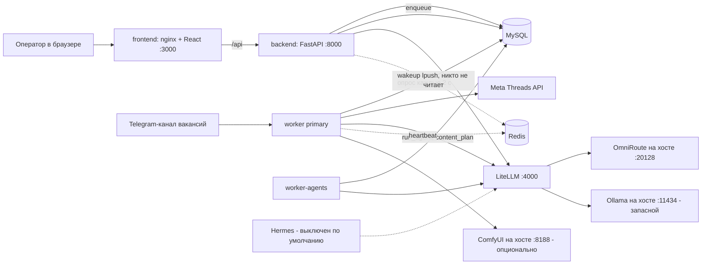
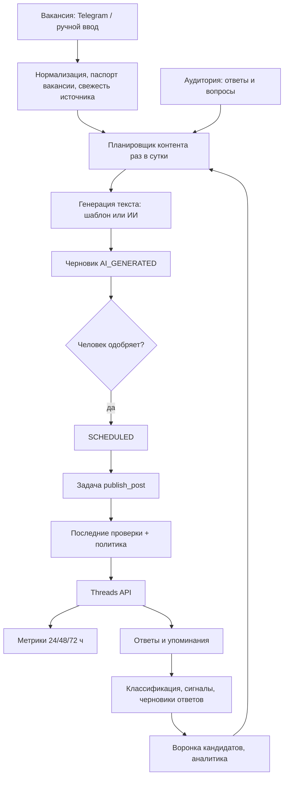
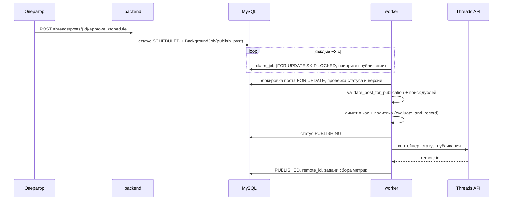
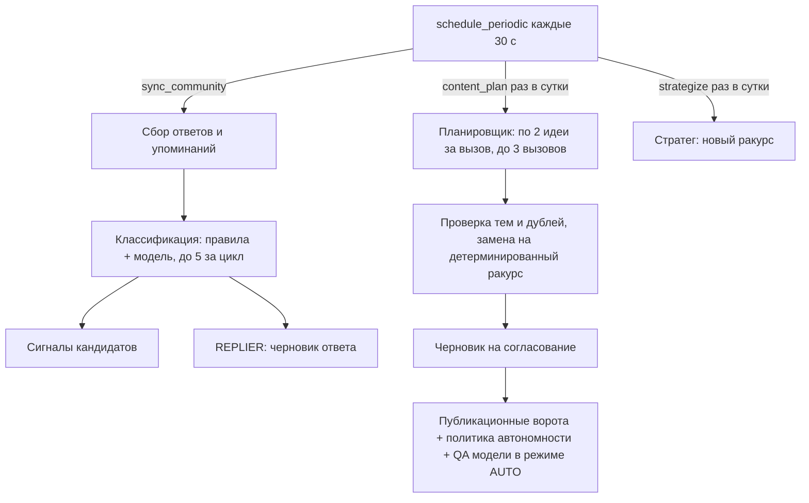
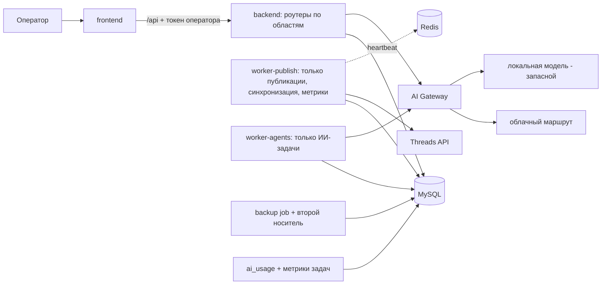

# PROJECT_FULL_AUDIT — Threads Recruitment Manager (`social-x-thetreads`)

Дата аудита: 2026-10-22. Объект: архив `social-x-thetreads-master.zip` (192 файла, 2,2 МБ).
Режим: только чтение. Код не менялся, зависимости не ставились, миграции и внешние вызовы не выполнялись.

**Как читать пометки уверенности**

- **[Факт]** — подтверждено прямым чтением исходника (указан файл).
- **[Вывод]** — логический вывод из прочитанного кода, в бою не проверялся.
- **[Не проверено]** — проверить не удалось, причина указана.

---

## 1. Executive Summary

Проект — рабочая система для рекрутингового аккаунта в Meta Threads (украинская аудитория в Польше). Она собирает вакансии (Telegram-канал, ручной ввод), с помощью ИИ пишет посты на украинском, проводит их через проверки и человеческое одобрение, публикует, читает ответы и упоминания, выделяет «сигналы» от кандидатов и считает воронку.

**Главное впечатление.** Для проекта такого размера безопасность публикации продумана неожиданно хорошо: есть конечный автомат статусов, детерминированная проверка текста прямо перед публикацией, защита от дублей, политика автономности с аварийной остановкой, а модельная проверка устроена «в одну сторону» (может заблокировать пост, но не разрешить). Сбои при публикации не приводят к повторной отправке.

**Слабые места** сосредоточены вокруг системы, а не вокруг самих постов:

1. **У API нет авторизации**, а «локальная защита» фактически ничего не проверяет (см. 10, D1). Сейчас спасает только привязка портов к `127.0.0.1`.
2. **Разделение воркеров не работает как задумано** — основной воркер тоже берёт медленные задачи ИИ и может задерживать публикации (D2).
3. **Расход токенов и стоимость нигде не считаются** (D5).
4. **Резервные копии только ручные**, а в базе будут данные кандидатов (D14).
5. **Ключ шифрования токена Threads выводится из ключа LiteLLM** — смена одного ломает другое (D9).
6. Два файла (`worker/main.py` — 2293 строки, `backend/app/api.py` — 1951 строка) стали слишком большими, и поддерживать их будет всё труднее.

**Чего я не смог сделать:** запустить тесты (в песочнице нет `fastapi`, `sqlalchemy`, `pytest`, а ставить зависимости запрещено), увидеть живую систему и боевую БД. Поэтому суждение о том, «что работает», основано на чтении кода и тестов, а не на запуске.

**Предыдущий аудит.** В репозитории лежит `AUDIT_REPORT.md` (13–21 октября 2026) с утверждениями вроде «96 passed», «8 сервисов healthy». Я эти цифры не воспроизводил и на них не опирался. По коду видно, что в проекте сейчас 331 тестовая функция в `tests/backend` — цифра 96 устарела.

---

## 2. Назначение проекта

Система «рекрутинговый менеджер Threads» (`README.md`, `docs/threads-manager-architecture.md`):

- хранит вакансии и агентства (`backend/app/models.py`: `Agency`, `Vacancy`);
- генерирует и проверяет посты, ведёт их через `DRAFT/AI_GENERATED → REVIEW → APPROVED → SCHEDULED → PUBLISHING → PUBLISHED` (`services.py: ALLOWED_TRANSITIONS`);
- публикует через официальный Threads API (`threads_client.py`), плюс есть заготовки Instagram/TikTok (`social_clients.py`) и локальная генерация изображений/видео через ComfyUI (`comfyui.py`);
- читает ответы и упоминания, классифицирует их, готовит черновики ответов;
- считает воронку: сигнал → подтверждённый контакт → кандидат → квалифицирован → нанят (`models.py: Candidate, CandidateStageEvent`);
- показывает аналитику и эксперименты с форматами постов.

Язык публикаций — украинский (`README.md`, раздел Language Policy); общение с владельцем — русский.

---

## 3. Технологический стек

| Слой | Технологии | Где |
|---|---|---|
| Backend | Python 3.12, FastAPI 0.115.6, SQLAlchemy 2.0.36 (async), Alembic 1.14, aiomysql, pydantic 2.10, structlog | `backend/requirements.txt` |
| Worker | тот же код (`backend/app`), точка входа `python -m worker.main` | `worker/main.py` |
| Frontend | React + TypeScript + Vite + Tailwind + TanStack Query, раздаётся nginx 1.27 | `frontend/` |
| БД | MySQL 8.4.3 (основной источник истины); SQLite только в тестах | `docker-compose.yml` |
| Очередь | таблица `BackgroundJob` в MySQL; Redis 7.4 используется только для heartbeat | `queue.py`, `worker/main.py` |
| ИИ | LiteLLM v1.103.0 (шлюз) → OmniRoute (внешний локальный шлюз) → «Gemini»-модели; запасной вариант — Ollama `qwen3:4b-instruct` | `litellm/config.yaml` |
| Агентный рантайм | Hermes Agent (`nousresearch/hermes-agent:v2026.9.24`), по умолчанию выключен | `hermes/`, профиль `hermes` |
| Медиа | ComfyUI (внешний, на хосте), ffmpeg | `comfyui.py`, `workflows/` |
| Инфраструктура | Docker Compose, PowerShell-скрипты для Windows 11 | `scripts/*.ps1` |

Версии образов и Python-пакетов закреплены — это хорошая практика. Исключение: фронтенд собирается через `npm install`, а не `npm ci` (`frontend/Dockerfile`).

---

## 4. Полная структура проекта

```
backend/app/        API, модели, ИИ, политика автономности, проверки качества (≈13 тыс. строк с worker)
  api.py            1951 строка, все маршруты + часть бизнес-логики
  ai.py             838 строк, клиент LiteLLM, промпты, планировщик идей
  threads_client.py 679 строк, Meta Threads API + шифрование токена + OAuth
  autonomy.py       политика MANUAL / SEMI_AUTO / AUTO, аварийная остановка
  post_validation.py, content_quality.py, quality_guard.py, model_qa.py   проверки текста
  vacancy_freshness.py, vacancy_inspection.py                            свежесть вакансий
  experiments.py (938), audience_profile.py, recruitment_intelligence.py аналитика/воронка
  comfyui.py, social_clients.py, media_restore.py                        медиа и соцсети
  supervisor.py     оперативный «страж» (починка зависших задач)
  poster_skills/    SKILL.md с правилами для автора постов
backend/alembic/versions/   17 миграций (0001–0017)
worker/main.py      2293 строки: очередь, публикация, синхронизация, планировщик, агенты
frontend/src/       12 страниц, api/client.ts, mock.ts (24 КБ), 20 тестов
litellm/, hermes/   конфигурации шлюза и агента
scripts/            backup/restore (PowerShell), проверки моделей, backfill
tests/backend/      331 тестовая функция
docs/, plans/       документы и планы (часть устарела, см. D17)
```

---

## 5. Карта архитектуры и диаграммы

### 5.1 Общая архитектура



### 5.2 Поток данных



### 5.3 Последовательность публикации



### 5.4 Взаимодействие сервисов (старт)

1. `mysql`, `redis` поднимаются и проходят healthcheck.
2. `litellm` стартует (без проверки готовности: `condition: service_started`).
3. `backend` ждёт mysql+redis+litellm, затем в `CMD` выполняет `alembic upgrade head` и запускает uvicorn (`backend/Dockerfile`).
4. `worker` и `worker-agents` ждут только mysql+redis+litellm, **не backend** — то есть могут стартовать до применения миграций (D12).
5. `frontend` ждёт здоровый backend.

### 5.5 Агентный workflow



Роли агентов (`enums.py: AgentRole`): SCOUT, STRATEGIST, WRITER, COMMUNITY, ANALYST, REPLIER, EXPERIMENTER. Маршруты моделей — `ai.py: MODEL_ROUTE`.

---

## 6. Описание основных компонентов

| Компонент | Файл | Что делает | Критичность |
|---|---|---|---|
| API | `backend/app/api.py` | 98 маршрутов: вакансии, посты, кандидаты, сообщество, аналитика, аккаунт, медиа | Высокая |
| Очередь | `backend/app/queue.py` | `enqueue` с ключом идемпотентности, запись в `BackgroundJob`, затем `LPUSH` в Redis | Высокая |
| Воркер | `worker/main.py` | `claim_job`, `process_job`, публикация, синхронизация, планировщик, восстановление зависших задач | Критическая |
| Ворота публикации | `post_validation.py`, `quality_guard.py` | Проверка языка, валюты, ставок, служебных маркеров, дублей | Критическая |
| Политика автономности | `autonomy.py` | Режим MANUAL/SEMI_AUTO/AUTO, лимиты, аварийная остановка, журнал `PolicyDecision` | Критическая |
| Модельная проверка | `model_qa.py` | Просит модель проверить пост; сбой проверки = «не пройдено» | Высокая |
| Threads-клиент | `threads_client.py` | OAuth, публикация в 2 шага, метрики, классификация ошибок Meta, шифрование токена (Fernet) | Критическая |
| ИИ-сервис | `ai.py` | Запросы к LiteLLM, промпты, JSON-разбор, пакетный планировщик | Высокая |
| Supervisor | `supervisor.py` | Наблюдает за состоянием, делает только обратимые локальные починки | Средняя |
| Фронтенд | `frontend/src/` | Панель оператора | Средняя |

---

## 7. Реальный workflow: жизненный цикл одной задачи

Пример: «ежедневный контент-план → публикация одного поста».

1. **Планирование.** Воркер в `schedule_periodic` раз в сутки ставит `content_plan` (ключ `content-plan:YYYYMMDD`). Упавший план в тот же день перезапускается с новым ключом (`worker/main.py:~2026`). [Факт]
2. **Генерация.** `content_plan` просит модель по 2 идеи за вызов (`PLANNER_BATCH_SIZE=2`), максимум 3 вызова. Повтор темы заменяется детерминированным ракурсом из подтверждённых фактов вакансии (`editorial_angles.py`). [Факт]
3. **Черновик.** Идея становится постом `AI_GENERATED`. Для типа `VACANCY` текст вообще собирается шаблоном без модели (`ai.py: render_vacancy_post`), чтобы ставки не искажались. [Факт]
4. **Одобрение.** Человек переводит пост в `REVIEW → APPROVED` и планирует. В режиме AUTO по README пост может быть одобрен автоматически, но только при прохождении свежести вакансии и модельной проверки. [Факт: `worker/main.py: publish_post`]
5. **Публикация.** Воркер берёт задачу `publish_post` с высшим приоритетом, блокирует строку поста, проверяет статус и версию, прогоняет детерминированные ворота, дубли, часовой лимит и политику, ставит `PUBLISHING`, вызывает Threads API. [Факт]
6. **После публикации.** Ставятся задачи сбора метрик; ответы подтягиваются в `sync_community` (каждые 300 с по умолчанию).
7. **Сбой посреди публикации.** Если воркер упал между «опубликовано» и записью в БД, задача при восстановлении получает `FAILED` с пометкой «проверьте вручную»; автоматической повторной отправки нет. [Факт: `recover_stale_jobs_in_session`]

---

## 8. Реализованные и незавершённые функции

| Функция | Статус | Где | Основание |
|---|---|---|---|
| Статусная машина постов, версии, ревизии | Реализовано | `services.py`, `models.py` | [Факт] код + тесты `test_post_lifecycle.py` |
| Публикация в Threads (2 шага, без повтора неоднозначного POST) | Реализовано | `threads_client.py`, `worker/main.py` | [Факт] код; живой Meta не проверялся |
| Финальные ворота + защита от дублей | Реализовано | `post_validation.py`, `worker/main.py: find_duplicate_of` | [Факт] |
| Политика автономности, аварийная остановка | Реализовано | `autonomy.py` | [Факт]; режим AUTO заблокирован без свежести и QA модели |
| Модельная проверка (односторонняя) | Реализовано | `model_qa.py` | [Факт] сбой = «не пройдено» |
| Импорт вакансий из Telegram | Реализовано | `worker/main.py: sync_telegram_vacancies` | [Факт]; Bot API не отдаёт историю канала |
| Сбор ответов/упоминаний, сигналы, воронка | Реализовано | `sync_community`, `models.py` | [Факт]; полнота данных зависит от прав Meta |
| Разведка новостей (Google News RSS) | Реализовано | `scout_sources` | [Факт] |
| Эксперименты с форматами | Реализовано, глубоко не проверено | `experiments.py` | [Не проверено] детально |
| Метрики и аналитика | Частично | `api.py: analytics` | собирает только views/likes/replies/reposts/quotes; нет кликов и DM |
| Поиск публичных постов Threads | Не работает без прав | `threads_client.py` (`keyword_search`) | нужен scope `threads_keyword_search`; см. `docs/meta-scopes-request.md` |
| Hermes как оркестратор | Реализовано, но спит | `hermes_client.py`, один вызов в `worker/main.py:1945` | выключен по умолчанию, из-за 13K-токенного промпта |
| Instagram / TikTok | Заготовка | `social_clients.py` | при `SOCIAL_LOCAL_ONLY=true` ограничены; публикация не проверена [Не проверено] |
| Генерация видео | Заготовка с «локальным фолбэком» | `comfyui.py` | нет проверки качества кадров, субтитров, звука; на этом этапе это не основная функция |
| Авторизация пользователей | **Отсутствует** | `security.py` (docstring: «intentionally has no user/session authentication yet») | [Факт] |
| Автоматические бэкапы | **Отсутствуют** | `scripts/backup-db.ps1` — запускается вручную | [Факт] |
| Учёт токенов и стоимости ИИ | **Отсутствует** | `litellm/config.yaml: disable_spend_logs: true` | [Факт] |

---

## 9. Результаты анализа кода

**Сильные стороны**

- Идемпотентная очередь: уникальный `idempotency_key`, повторный `enqueue` с другим payload отвергается (`queue.py`). [Факт]
- Блокировки `SELECT … FOR UPDATE SKIP LOCKED` при взятии задач и `FOR UPDATE` при публикации. [Факт]
- Миграции Alembic ведутся последовательно, есть тест `test_migrations.py`.
- Тестов много (331) и они покрывают именно рискованные места: дубли, гейты, восстановление, OAuth, политику.

**Проблемы кода**

| № | Проблема | Где | Последствие |
|---|---|---|---|
| C1 | Два «монолита»: 2293 и 1951 строка. Бизнес-логика (расчёт аналитики, изменение режима автономности) живёт прямо в обработчиках маршрутов | `worker/main.py`, `api.py` | Трудно тестировать и менять; рост риска регрессий |
| C2 | Плотный стиль: несколько операторов в одной строке (`if not row: row = …; db.add(row)`) | `api.py` (`connect_account`, `disconnect_account`, `seed`) | Читаемость, ошибки при правках |
| C3 | Доменный код бросает `HTTPException` из FastAPI (`ai.py`, `post_validation.py`, `supervisor.py`, `quality_guard.py`) | перечисленные файлы | Воркер зависит от веб-фреймворка; у `HTTPException` нет атрибута `retryable`, поэтому ошибки ИИ в задачах не повторяются (см. D6) |
| C4 | Новое соединение `httpx.AsyncClient` на каждый запрос к ИИ и новое `Redis.from_url` на каждый heartbeat/enqueue | `ai.py: _chat`, `queue.py`, `worker/main.py: heartbeat` | Лишние накладные расходы; не критично при текущей нагрузке |
| C5 | 25 широких `except Exception` | `worker/main.py` (10), `api.py` (8) и др. | Часть ошибок глотается; в основном обоснованно (fail-closed), но требует выборочного пересмотра [Вывод] |
| C6 | `frontend/src/api/mock.ts` (24 КБ) — параллельная реализация API на клиенте | фронтенд | Риск расхождения с реальным API |
| C7 | Всего 20 тестов фронтенда на 12 страниц | `frontend/src/test/` | Слабое покрытие интерфейса |

---

## 10. Безопасность и отказоустойчивость

### Что сделано хорошо [Факт]

- Токены Threads хранятся зашифрованными (Fernet), наружу не отдаются; токен передаётся в заголовке `Authorization` (`threads_client.py`), ошибки Meta очищаются и усекаются.
- Подпись вебхука проверяется через `hmac.compare_digest`.
- `.env` и секреты в `.gitignore`; в `.env.example` — только шаблонные значения. В архиве файла `.env` нет.
- Порты MySQL, Adminer, LiteLLM, Hermes, backend, frontend привязаны к `127.0.0.1`; Redis наружу не публикуется; сеть `data_net` внутренняя.
- Автопубликация по умолчанию выключена; конечные ворота стоят **внутри воркера непосредственно перед вызовом Meta**, поэтому ужесточение политики останавливает уже стоящую в очереди публикацию.
- Внешний текст рассматривается как данные: сообщество не может менять настройки; `_mask_handles` скрывает @-имена в фактах для ответов.

### Обнаруженные проблемы

(Нумерация D-пунктов общая для всего отчёта; полная сводка — в разделе 14. Пункт D17 в тексте раздела 13 — устаревшая документация; в этом разделе логи обозначены как D17a.)

**D1. Нет авторизации; «локальная защита» не защищает** — **P0 при выходе за localhost, P1 сейчас** [Факт]
`backend/app/security.py: require_local_operator` разрешает любой адрес из частных диапазонов (`10.0.0.0/8`, `172.16.0.0/12`, `192.168.0.0/16`). Все запросы с фронтенда идут через nginx внутри Docker-сети, и backend видит адрес контейнера nginx (`172.x`) — то есть проверка **всегда проходит** (`frontend/nginx.conf` передаёт `X-Real-IP`, но backend его не читает). Кроме того, защита вызывается только в 14 из 98 маршрутов. Без неё остаются, например: `POST /threads/posts/{id}/publish`, `PATCH /threads/autonomy`, `PATCH /threads/settings`, `POST /threads/autonomy/emergency-stop`, `POST /threads/account/token` (приём токена Meta), `POST /threads/account/disconnect`, `DELETE /vacancies/{id}`, `POST /seed`, `GET /threads/oauth/start`.
Последствия: всё, что может послать запрос на `localhost:8000` или `:3000`, управляет аккаунтом. Для запросов из веб-страниц это отчасти смягчает браузер, но серверной защиты нет [Вывод]: POST без тела и без нестандартных заголовков (например, `/approve`, `/publish`, `/emergency-stop`) не требует предварительного CORS-запроса. README просит не публиковать API через туннель — это правильно, но пока это единственный барьер.
Исправление: добавить один обязательный токен оператора (заголовок или защищённая cookie) на весь роутер `/api` кроме `/health` и вебхука; заодно требовать нестандартный заголовок (защита от CSRF).

**D9. Ключ шифрования токена выводится из ключа LiteLLM** — P1 [Факт]
`threads_client.py: _fernet` — если `THREADS_TOKEN_KEY` пуст, берётся `SHA-256(LITELLM_MASTER_KEY)`; тот же ключ защищает OAuth-state и (в `social_clients.py`) токены соцсетей. Нет KDF и соли. Смена ключа шлюза молча делает токены нечитаемыми (код об этом знает: «encryption key changed?»). Также один секрет выполняет три роли.
Исправление: отдельный обязательный `THREADS_TOKEN_KEY`; поддержка нескольких ключей (`MultiFernet`) для ротации.

**D14. Резервные копии — только вручную** — P1 [Факт]
`scripts/backup-db.ps1` запускается оператором; расписания нет; копии по умолчанию лежат на той же машине (`backups/`). Хорошая сторона: дамп проверяется `gzip -t`, восстановление защищено подтверждением. Но в БД будут контакты кандидатов — потеря диска означает потерю всего.
Исправление: запланированная задача (Windows Task Scheduler) + копия на отдельный носитель + периодическая проверка восстановления.

**D15. Вебхук без подписи при пустом `THREADS_APP_SECRET`** — P3 [Факт] (`api.py: webhook_notify`). Эффект ограничен: можно лишь вызвать внеочередную синхронизацию, не чаще раза в минуту (ключ идемпотентности).

**D16. OAuth-state не привязан к браузеру** — P3 [Вывод] (`threads_client.py: make_state`). State — зашифрованная метка времени, действует 10 минут и не связана с сессией. Это оставляет окно для подмены аккаунта при входе (login CSRF). Риск низкий при локальном использовании.

**D17a. Редакция логов по именам ключей** — P3 [Факт] (`logging.py`). Маскируются только поля верхнего уровня с именами `access_token|api_key|password|app_secret`. Значения внутри текстов исключений не фильтруются. Реальная утечка в коде не найдена, потому что ошибки Meta очищаются заранее.

**D18. Секрет Telegram-бота** — P0 организационно [Факт: README]
README сам сообщает, что токен бота «был раскрыт при локальной настройке и должен быть перевыпущен». Подтверждения перевыпуска в архиве нет. Значение токена в архиве я не искал и в отчёт не вношу.

**Контейнеры работают от root** — P3 [Факт]: в `backend/Dockerfile` и `worker/Dockerfile` нет `USER`.

**Отказоустойчивость** [Факт]
- Зависшие задачи (RUNNING > 10 минут) возвращаются в очередь или помечаются FAILED; для публикаций неопределённый исход всегда становится FAILED «проверьте вручную».
- Часовой лимит публикаций и дневные лимиты политики.
- Круговой блок «app_blocked» откладывает задачи на час, не расходуя попытки.
- Повторы: для обычных задач максимум 3 попытки и пауза `30 с × попытка`, но только для исключений с флагом `retryable` (в основном Meta API).

---

## 11. AI-инфраструктура

| Вопрос | Ответ по коду |
|---|---|
| Провайдеры и модели | LiteLLM → OmniRoute (`antigravity/gemini-3.1-flash-lite`, `gemini-3-flash`, `gemini-3.8-flash-high`) → запасной локальный `qwen3:4b-instruct`. Названия моделей я проверить не могу [Не проверено]. |
| Маршрутизация | Логические алиасы `free-fast/default/reasoning/local` и цепочки запасных маршрутов в `litellm/config.yaml`. Роль → алиас: `ai.py: MODEL_ROUTE`. |
| Память агентов | Нет «памяти диалога». Есть «редакторская память» (подтверждённые правила стиля, `editorial_memory.py`) и профиль аудитории (`audience_profile.py`). |
| Инструменты агентов | Hermes не получает терминала/файлов (`hermes/config.yaml`); основной контур — детерминированный код, модель только пишет текст/классифицирует. |
| Проверка результата | Детерминированные ворота + (в AUTO) модельная проверка, односторонняя. |
| Галлюцинации | Факты вакансий вставляются шаблоном; промпт запрещает выдумывать ставки; конечная проверка сверяет ставки/валюту. Это сильная защита. |
| Токены и стоимость | **Не отслеживаются** (`disable_spend_logs: true`, в `ai.py` нет разбора `usage`). |
| Ограничения ресурсов | `max_tokens=600`, таймаут 280 с, лимит ответа 128 КБ, до 5 анализов комментариев за цикл. |
| Одобрение человеком | Любой пост — в MANUAL; ответы людям — всегда человек (`ALWAYS_HUMAN_ACTIONS = {REPLY}`). |
| Автономность | Регулируется политикой; AUTO невозможен без свежести вакансии и QA. |

**Риски и возможности**

- **D19. Внешний шлюз OmniRoute и «бесплатные» модели.** Основной маршрут идёт через сторонний шлюз на хосте и «antigravity»-провайдера. Стабильность, условия использования и конфиденциальность текстов комментариев (в модель уходит текст людей) зависят от стороннего сервиса. Приватность частично смягчена маскированием @-имён [Вывод]. Рекомендую явно описать это в документации и держать локальную модель рабочим запасным вариантом.
- **D5. Нет учёта токенов** — P1. Включить сбор `usage` из ответа шлюза, писать в `AgentRun`/отдельную таблицу, показывать суммы на странице «Агенты». Без платных моделей это даёт видимость: какая роль «сжигает» время и сколько раз срабатывает запасная модель.
- **D6. Ретраи ИИ фактически выключены** — P2 [Факт]. `ai_retries=0` (`config.py`) делает цикл повторов в `AIService._request` мёртвым кодом: корректирующий повтор после невалидного JSON никогда не происходит. А `HTTPException` не имеет `retryable`, поэтому задачи с ошибкой ИИ не повторяются на уровне очереди. Спасают детерминированные фолбэки. Предложение: 1 повтор только при невалидном JSON/пустом ответе, не при таймауте.
- **Как улучшить качество без платных моделей:** (1) сделать запасную локальную модель ступенью «валидировать и править», а не только резервом; (2) кэшировать результаты классификации одинаковых комментариев; (3) снизить `temperature` для фактических постов (сейчас 0,7 везде в `ai.py: _chat`); (4) копить набор «золотых» примеров для `scripts/evaluate_writer_quality.py` и запускать его при смене модели; (5) вынести `PLANNER_BATCH_SIZE` в настройку, чтобы при быстрой облачной модели просить все идеи за один вызов.
- **Hermes** фактически дремлет: один вызов под флагом (`worker/main.py:1945`), README объясняет, что он замедляет конвейер на малой модели. Это лишний сервис в стеке. Рекомендация: оставить опциональным и не вкладываться, пока нет быстрой модели.

---

## 12. Производительность

| Узкое место | Доказательство | Эффект | Приоритет |
|---|---|---|---|
| `GET /threads/analytics` читает **все** опубликованные посты и **все** снимки метрик в память и считает в Python при каждом запросе | `api.py: analytics` | Время и память растут линейно с историей; страница «Аналитика» замедляется со временем | P2 |
| Воркер последовательный: одна задача за раз, опрос БД каждые 2 с | `worker/main.py: run_forever` | Публикация ждёт, пока не закончится текущая задача (до 280 с на ИИ-вызов) | P1 (см. D2) |
| Redis-«пробуждение» никто не читает | `queue.py` пишет в `threads:jobs:wakeup`, `grep` не находит `BRPOP/BLPOP` ни в воркере, ни в бэкенде | Список в Redis только растёт; задержка публикации до 2 с без пользы от Redis | P2 |
| `pool_pre_ping=False`, нет `pool_recycle` | `database.py` | После простоя MySQL может закрыть соединение; воркер самовосстановится через 5 с, но задача может упасть [Вывод, не воспроизведено] | P2 |
| Новое HTTP-соединение на каждый вызов ИИ | `ai.py: _chat` | Небольшие накладные расходы | P3 |
| Локальная модель 4B: 90–130 с на запрос (замер из README) | `README.md` | Узкое место при падении облачного маршрута | — |
| Нет политики хранения: `ActivityEvent`, `PolicyDecision`, `BackgroundJob`, `AgentRun`, `PostMetric` только растут | `grep` по `retention/purge/cleanup` в `backend`/`worker` — пусто | Рост БД; медленные запросы по журналам [Вывод] | P2 |

Фоновые задачи на сеть разумно ограничены: 5 анализов комментариев за цикл, 10 ответов за запуск.

---

## 13. Технический долг

1. Монолитные `worker/main.py` и `api.py`.
2. Доменный код зависит от `HTTPException`.
3. Три источника лимитов публикаций: `docker-compose.yml` (3/час), `config.py` (4/час), настройка в БД и `autonomy.DEFAULT_LIMITS` (4/час). Фактически действует минимальное значение, но понять это трудно.
4. Документы описывают разное: `docs/threads-manager-architecture.md` называет проект «greenfield» и говорит «worker consumes Redis jobs», тогда как реальная очередь — таблица MySQL (D17).
5. README противоречит себе: «по умолчанию безопасно, AUTO_POST выключен» и далее «`auto_post` включён для этого локального проекта».
6. Параллельная фронтенд-копия API (`mock.ts`).
7. Заготовки Instagram/TikTok/видео, не доведённые до рабочего контура, увеличивают поверхность кода.

---

## 14. Обнаруженные ошибки (сводка)

Приоритет: P0 — критично, P1 — важно, P2 — архитектура/надёжность, P3 — мелочи.

| ID | Описание | Файл | Уверенность | Приоритет |
|---|---|---|---|---|
| D1 | Нет авторизации API; `require_local_operator` всегда пропускает запросы через nginx и применяется к 14 из 98 маршрутов | `security.py`, `api.py`, `nginx.conf` | Высокая [Факт] | P0/P1 |
| D2 | Основной воркер берёт `run_agent` и `content_plan`, хотя `worker-agents` создан для их изоляции | `worker/main.py: claim_job`, `run_forever`, `docker-compose.yml` | Высокая [Факт] | P1 |
| D3 | `heartbeat` обновляет Redis/`SyncState`, но не `BackgroundJob.locked_at`; задача дольше 10 минут может быть «восстановлена» и взята повторно, пока ещё работает | `worker/main.py: process_with_heartbeat`, `recover_stale_jobs_in_session` | Средняя [Вывод]: `content_plan` способен идти до 3×280 с = 840 с | P1 |
| D4 | Redis-«пробуждение» без потребителя; README обещает «wakeups/locks», блокировок в Redis нет | `queue.py`, `README.md` | Высокая [Факт] | P2 |
| D5 | Нет учёта токенов/стоимости ИИ | `litellm/config.yaml`, `ai.py` | Высокая [Факт] | P1 |
| D6 | `ai_retries=0` — корректирующий повтор мёртв; ошибки ИИ без `retryable` | `config.py`, `ai.py: _request` | Высокая [Факт] | P2 |
| D7 | Аналитика читает всю историю в память | `api.py: analytics` | Высокая [Факт] | P2 |
| D8 | Нет `pool_recycle`/`pre_ping` | `database.py` | Низкая [Вывод] | P2 |
| D9 | Один секрет для LLM-шлюза, шифрования токенов и OAuth-state; нет KDF и ротации | `threads_client.py`, `social_clients.py` | Высокая [Факт] | P1 |
| D10 | `POST /seed` без защиты и без проверки mock-режима; создаёт демо-вакансии в боевой БД | `api.py: seed` | Высокая [Факт] | P2 |
| D11 | Контейнеры от root; фронтенд собирается `npm install` | `Dockerfile` ×3 | Высокая [Факт] | P3 |
| D12 | `worker` может стартовать до миграций (зависит не от backend) | `docker-compose.yml` | Средняя [Вывод] | P3 |
| D13 | Нет политики хранения журналов | весь backend | Высокая [Факт] | P2 |
| D14 | Бэкапы только вручную, на той же машине | `scripts/backup-db.ps1` | Высокая [Факт] | P1 |
| D15 | Вебхук принимается без подписи при пустом `THREADS_APP_SECRET` | `api.py` | Высокая [Факт] | P3 |
| D16 | OAuth-state не привязан к сессии | `threads_client.py` | Средняя [Вывод] | P3 |
| D18 | Токен Telegram-бота, по словам README, скомпрометирован, перевыпуск не подтверждён | `README.md` | Высокая [Факт] — но только как заявление README | P0 (организационно) |
| D19 | Зависимость от стороннего шлюза/«бесплатных» моделей | `litellm/config.yaml` | Средняя [Вывод] | P2 |

---

## 15. Возможности улучшения (подробно по главным пунктам)

### I-1. Единая авторизация API (закрывает D1, D10, D15)
- **Сейчас:** защита по IP, практически не работает.
- **Решение:** зависимость FastAPI `require_operator`, проверяющая секретный токен из `.env` (`OPERATOR_TOKEN`), на весь роутер; фронтенд хранит токен и шлёт в заголовке `X-Operator-Token`; `/health*` и вебхук Meta исключены; `/seed` — только в mock-режиме.
- **Файлы:** `backend/app/security.py`, `backend/app/api.py` (подключение к роутеру), `backend/app/main.py`, `frontend/src/api/client.ts`, `.env.example`, `docker-compose.yml`, тесты.
- **Переиспользовать:** `require_local_operator` как второй слой; существующие тесты `test_social_contract.py`.
- **Риски:** сломать вебхук Meta и OAuth-callback (они должны быть открыты).
- **Эффект:** закрывает главный риск безопасности. **Сложность: 4/10.**
- **Проверка:** тест «без токена любой маршрут кроме health/webhook/callback отвечает 401».

### I-2. Разделить воркеры по-настоящему (D2)
- **Решение:** для `worker_role != "agents"` исключать `run_agent` и `content_plan` в `claim_job`; либо задавать `WORKER_JOB_KINDS` явным списком в `docker-compose.yml` для основного воркера.
- **Файлы:** `worker/main.py` (`claim_job`), `docker-compose.yml`, тест `test_worker_queue.py`.
- **Риски:** при остановке `worker-agents` агентные задачи будут копиться — нужен алерт.
- **Эффект:** публикации перестают зависеть от ИИ. **Сложность: 2/10.**
- **Проверка:** тест, что основной воркер не берёт `content_plan`, а агентный — берёт.

### I-3. Продлевать блокировку задачи (D3)
- **Решение:** в `process_with_heartbeat` обновлять `BackgroundJob.locked_at` каждые 20 секунд.
- **Файлы:** `worker/main.py`, `test_job_recovery.py`.
- **Риски:** минимальные. **Сложность: 2/10.**
- **Проверка:** тест с имитацией долгой задачи (>10 минут по часам) — не должна восстанавливаться.

### I-4. Учёт токенов и времени ИИ (D5)
- **Решение:** разбирать `usage` и время ответа в `AIService._chat`, писать в новую таблицу `ai_usage` (роль, алиас, фактическая модель, prompt/completion токены, время, было ли срабатывание запасной модели); показывать в `AgentsPage`.
- **Файлы:** `ai.py`, `models.py` + миграция 0018, `api.py`, `frontend/src/pages/AgentsPage.tsx`, `litellm/config.yaml` (оставить `disable_spend_logs`, учёт ведёт приложение).
- **Эффект:** видно, какая роль медленная/дорогая; можно ставить лимиты. **Сложность: 4/10.**

### I-5. Автоматические бэкапы с проверкой (D14)
- **Решение:** задача планировщика Windows (или контейнер `backup` по расписанию) → `backup-db.ps1` раз в сутки + копия на второй носитель; раз в месяц тест восстановления во временную БД; бэкап `media_data`.
- **Файлы:** `scripts/*.ps1`, `README.md`.
- **Риски:** хранение персональных данных — шифровать и ограничивать доступ.
- **Сложность: 3/10.**

### I-6. Отдельный ключ шифрования и ротация (D9)
- **Решение:** обязательный `THREADS_TOKEN_KEY`, `MultiFernet` для чтения старых и записи новых; миграция перешифровки токена командой.
- **Файлы:** `threads_client.py`, `social_clients.py`, `config.py`, `.env.example`, тесты `test_oauth_and_webhook.py`.
- **Риск:** при ошибке токен станет нечитаемым — перед миграцией сделать бэкап. **Сложность: 3/10.**

### I-7. Политика хранения данных (D13)
- **Решение:** еженедельная задача, удаляющая/сжимающая `ActivityEvent`, `PolicyDecision`, завершённые `BackgroundJob` и старые `AgentRun` старше N дней (с отдельным хранением того, что нужно для аудита).
- **Файлы:** `worker/main.py` (новая задача), `models.py` (индексы по дате), `README.md`. **Сложность: 3/10.**

### I-8. Аналитика через SQL и кэш (D7)
- **Решение:** агрегаты считать запросами `GROUP BY` с окном дат; кэшировать ответ на 60–300 с.
- **Файлы:** `api.py: analytics`, `content_analysis.py`, `recruitment_intelligence.py`. **Сложность: 5/10.**
- **Проверка:** сравнить результаты со старой версией на копии БД.

### I-9. Разрезать монолиты (C1)
- **Решение:** без переписывания; вынести из `worker/main.py` модули `publishing.py`, `community_sync.py`, `planner.py`, `scheduler.py`; из `api.py` — `routers/*.py` по группам. Делать по одному модулю за раз, с зелёными тестами на каждом шаге.
- **Сложность: 6/10.** Риск регрессий компенсируется 331 тестом.

### I-10. Починка мелочей надёжности (D8, D12, D6)
- `pool_recycle=1800` в `database.py`; `depends_on: backend: service_healthy` для воркеров; 1 корректирующий повтор при невалидном JSON. **Сложность: 2/10.**

### Дополнительные возможности (P3)
- Метрики кликов/переходов через UTM-ссылки в CTA (даёт измеримую воронку, API Threads этого не отдаёт).
- Уведомления оператору (Telegram) при `FAILED`, блокировке Meta, остановке воркера.
- Экспорт аналитики в CSV.

---

## 16. Приоритизированный Roadmap

### Фаза 0 — Срочная гигиена (1–2 дня)
- **Цель:** закрыть организационные риски.
- **Задачи:** перевыпустить токен Telegram-бота (D18); убедиться, что `.env` не попадал в Git/архивы; зафиксировать единый лимит публикаций в одном месте; исправить противоречия в README.
- **Зависимости:** нет. **Риск:** нет.
- **Критерий готовности:** старый токен не работает; в документации один источник правды по лимитам.

### Фаза 1 — Безопасность и целостность (неделя 1)
- **Цель:** авторизация, ключи, бэкапы.
- **Задачи:** I-1, I-6, I-5.
- **Компоненты:** `security.py`, `api.py`, `threads_client.py`, `scripts/`, `frontend/api/client.ts`.
- **Тесты:** 401 без токена; вебхук и OAuth-callback остаются доступными; токен читается после ротации ключа; восстановление бэкапа во временную БД.
- **Критерий:** ни один изменяющий маршрут не работает без токена; есть ежедневный бэкап и подтверждённое восстановление.

### Фаза 2 — Надёжность воркеров (неделя 2)
- **Цель:** публикации не зависят от ИИ, задачи не дублируются.
- **Задачи:** I-2, I-3, I-10 (+ D6).
- **Тесты:** основной воркер не берёт агентные задачи; долгая задача не «восстанавливается»; воркеры ждут миграций.
- **Критерий:** публикация стартует в течение 5 секунд после наступления времени, даже когда идёт `content_plan`.

### Фаза 3 — Наблюдаемость и данные (недели 3–4)
- **Цель:** видеть стоимость и нагрузку, ограничить рост БД.
- **Задачи:** I-4, I-7, I-8.
- **Критерий:** на странице «Агенты» видны токены и время по ролям; размер БД стабилен при неделе работы; `/threads/analytics` отвечает быстрее заданного порога на копии с большой историей.

### Фаза 4 — Структурное развитие (месяц 2)
- **Цель:** упростить поддержку.
- **Задачи:** I-9; расширить тесты фронтенда; решить судьбу Hermes, Instagram, TikTok и видео (довести или убрать из кода).
- **Критерий:** ни один файл не больше ~800 строк; покрытие тестами фронтенда ключевых страниц.

---

## 17. TOP-10 самых полезных улучшений

1. **Авторизация API** (I-1): закрывает главный риск.
2. **Реальное разделение воркеров** (I-2): публикации больше не ждут ИИ.
3. **Продление блокировки задач** (I-3): исключает двойной запуск долгих задач.
4. **Автоматические бэкапы + проверка восстановления** (I-5).
5. **Отдельный ключ шифрования токена + ротация** (I-6).
6. **Учёт токенов и времени ИИ** (I-4).
7. **Политика хранения журналов** (I-7).
8. **Аналитика через SQL с кэшем** (I-8).
9. **Единый источник правды по лимитам и режимам** (устраняет путаницу между compose, `config.py` и БД).
10. **Постепенное разрезание `worker/main.py` и `api.py`** (I-9).

---

## 18. Рекомендуемая целевая архитектура

Не новая система, а текущая с несколькими изменениями.



Принципы: одна точка авторизации; публикация изолирована от ИИ; домен не зависит от FastAPI; журналы имеют срок хранения; Redis либо используется (heartbeat, блокировки), либо убирается.

---

## 19. План безопасной реализации

1. Перед любыми изменениями — бэкап БД и `media_data`, копия `.env`.
2. Работать в отдельной ветке; одно улучшение — один коммит; после каждого запускать `docker compose --profile test run --rm backend-test` и `frontend-test`.
3. Миграции (`ai_usage`, индексы) — только после бэкапа и сначала на копии БД.
4. Первые изменения проверять в mock-режиме (`THREADS_MOCK_MODE=true`, `AI_MOCK_MODE=true`, все `AUTO_*` выключены).
5. Любое изменение авторизации — сначала включить в «мягком режиме» (только логировать отказы), затем в строгом.
6. Первую реальную публикацию после изменений — вручную, одним тестовым постом.
7. Откат: каждое изменение за флагом конфигурации или отдельным коммитом, чтобы его можно было отменить без потери данных.

---

## 20. Вопросы, требующие дополнительных проверок

1. **Запуск тестов** — невозможен в этой среде (нет зависимостей, установка запрещена). Нужно выполнить `docker compose --profile test run --rm backend-test` и `frontend-test` у вас и сверить количество.
2. **Живое состояние** — я не видел работающую систему, БД, логи, реальные права Meta (`threads_keyword_search`, `threads_manage_replies`), срок действия токена.
3. **`.env`** — в архиве его нет; проверить, что значения секретов уникальны, `THREADS_MOCK_MODE`/`AI_MOCK_MODE` в нужных значениях, `AUTO_*` соответствуют вашему намерению, токен Telegram перевыпущен.
4. **Модельные идентификаторы** (`gemini-3.8-flash-high` и др.) и условия использования OmniRoute/«antigravity» — проверить у провайдера.
5. **Не глубоко изучено:** `experiments.py`, `recruitment_intelligence.py`, `audience_profile.py`, `editorial_angles.py`, `comfyui.py`, `social_clients.py`, страницы фронтенда, большая часть `content_quality.py`. Здесь возможны проблемы, о которых я не сужу.
6. **Качество украинского текста** на реальных публикациях — нужна выборка живых постов; кодом это не проверить.
7. **Поведение при простое MySQL** (D8) — воспроизвести: оставить стек на ночь и посмотреть журналы.
8. **Реальная длительность `content_plan`** при падении облачного маршрута на локальную модель (D3): замерить фактические секунды.
9. **Права и конфиденциальность данных кандидатов** — нужна политика хранения и согласия (GDPR/польское законодательство); это юридический вопрос, который код не решает.

---

### Ответы на пять главных вопросов владельца

1. **Как устроен проект:** веб-панель + API + два воркера + MySQL; ИИ только пишет и классифицирует, а решение о публикации принимает детерминированный код и политика автономности (разделы 5–7).
2. **Что работает:** жизненный цикл поста, ворота качества, защита от дублей, политика, сбор ответов и воронка — по коду всё на месте и покрыто тестами. Живую работу я не проверял (раздел 8, 20).
3. **Проблемы:** нет авторизации API, воркеры разделены только на словах, нет учёта токенов, бэкапы ручные, общий ключ для шифрования, два раздутых файла (раздел 14).
4. **Что улучшить:** TOP-10 в разделе 17.
5. **Порядок действий:** фазы 0–4 в разделе 16; начинать с перевыпуска токена Telegram и авторизации API.
